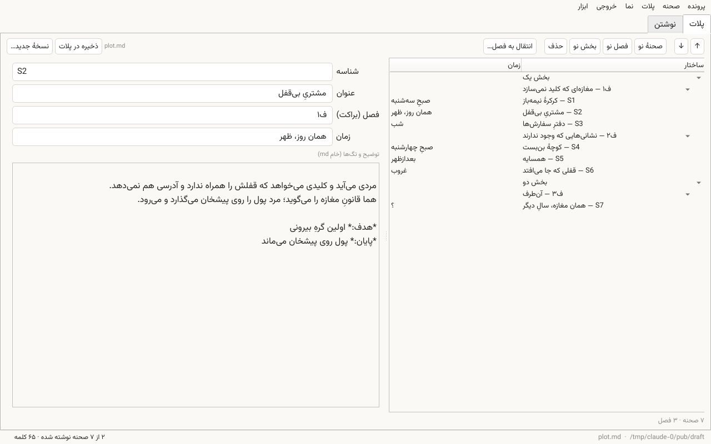
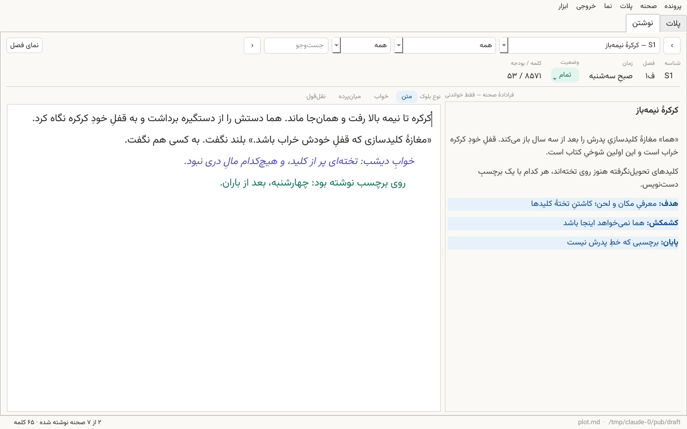
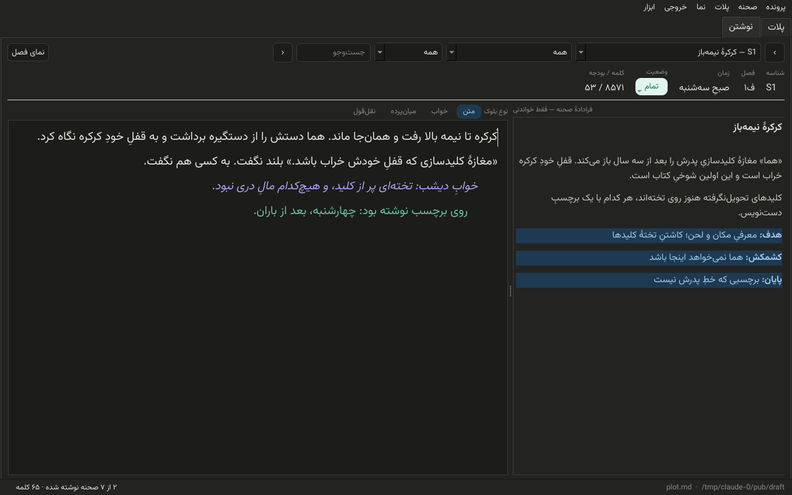

# دبیر

اسکریونر برایم زیادی پیچیده بود و چیزهایی که می‌خواستم را نداشت.

ابزار نوشتن صحنه‌محور فارسی، برای رمان و هر متن بلند دیگری که ساختار دارد.

دو تب دارد: **پلات** که ساختار کتاب را می‌سازد و در یک فایل Markdown می‌نویسد، و **نوشتن** که نثر هر صحنه را جدا نگه می‌دارد.

منطقش ساده است: پلات یک فایل md است و تنها منبع ساختار؛ نثر در فایل‌های جداگانه، هر صحنه یک فایل. برنامه هیچ‌وقت نثر را داخل پلات نمی‌ریزد و هیچ‌وقت پلات را از نو تولید نمی‌کند. هر چیزی که نوشته‌ای، با هر ویرایشگر دیگری هم خواندنی می‌ماند.

متاسفانه ابزار کار اشتراکی ندارد. شاید در ورژن‌های بعد اضافه شود.



---

## نصب

نیازمندی: پایتون ۳٫۸ به بالا و یکی از `PySide6` یا `PyQt5`.

```bash
git clone https://github.com/bonvari/dabir.git
cd dabir
pip install -r requirements.txt
python dabir.py
```

قلم پیشنهادی [وزیرمتن](https://github.com/rastikerdar/vazirmatn) است. اگر نصب نباشد، برنامه سراغ وزیر، ساحل، شبنم، ایران‌سنس و بعد قلم‌های سیستم می‌رود و در نوار پایین خبر می‌دهد.

بار اول فایل پلات را می‌پرسد. اگر پلات نداری: **پرونده ← پلات تازه از تمپلیت…**، یا `examples/sample_plot.md` را باز کن تا ببینی چه شکلی است.

---

## تب پلات

درخت بخش ← فصل ← صحنه در یک سمت، فرم صحنه در سمت دیگر.

| کار | چطور |
|---|---|
| جابه‌جایی | دکمه‌های ↑ ↓ — روی صحنه، فصل یا بخش انتخاب‌شده |
| صحنهٔ نو | بعد از صحنهٔ انتخاب‌شده، یا ته فصل انتخاب‌شده |
| فصل نو | ورودی مثل `ف۳ — عنوان فصل` |
| بخش نو | ورودی مثل `بخش دو` |
| انتقال به فصل | صحنه را به ته فصل مقصد می‌برد |
| حذف | صحنه، فصل (با یا بی صحنه‌هایش)، یا بخش |
| ذخیره | `Ctrl+Shift+S` |

**فرم صحنه:** شناسه، عنوان، فصل (براکت)، زمان، و یک کادر خام برای توضیح و تگ‌ها. کادر خام دقیقاً همان خطوطی است که در فایل پلات می‌نشیند — هر چه Markdown بپذیرد، بولد و لینک و جدول، سالم می‌ماند.

**فیلد «فصل (براکت)»** همان چیزی است که داخل `[...]` نوشته می‌شود. اگر یادداشت خودت را آنجا داری — چیزی مثل `ف۱۰٫۵` یا `ف۹ ↔ نسخهٔ دستنویس ف۱۱` — دست‌نخورده می‌ماند.

چند قاعده:

- **شناسه‌ها ثابت‌اند.** ترتیب صحنه = ترتیب فایل. جابه‌جایی شناسه را عوض نمی‌کند، پس فایل نثر صحنه هیچ‌وقت گم نمی‌شود. شناسهٔ تکراری پذیرفته نمی‌شود.
- **↑↓ که از مرز فصل رد شود**، صحنه عملاً فصلش عوض می‌شود و براکتش هم به‌روز می‌شود.
- **فصل که جابه‌جا شود**، همهٔ صحنه‌هایش با او می‌روند.
- **حذف صحنه** فقط از پلات برمی‌دارد. نثرش روی دیسک می‌ماند و در «ابزار ← صحنه‌های یتیم» دیده و بازیابی می‌شود. هیچ نثری هرگز پاک نمی‌شود.

---

## نوشتن در فایل پلات

بازنویسی کامل نیست؛ جراحی است. هر صحنه بازهٔ خطوط خام خودش را نگه می‌دارد و فقط همان‌ها جابه‌جا یا عوض می‌شوند. هر چه بیرون ناحیهٔ صحنه‌هاست — مقدمه، یادداشت‌ها، پیوست‌ها — دست نمی‌خورد، و داخل ناحیه هم نشانه‌هایی مثل ✅ و 🔒 و ◈ و `**[v3]**` سر جایشان می‌مانند. پایان خط (LF یا CRLF) هم حفظ می‌شود.

این ادعا آزمون دارد: روی یک پلات واقعی ۱۵۵ صحنه‌ای، یک دور ویرایش بی‌اثر روی تک‌تک صحنه‌ها، خروجی بایت‌به‌بایت برابر با ورودی. در `tests/` همین آزمون روی پلات نمونه هم هست.

**بکاپ:** پیش از هر ذخیره، نسخهٔ قبلی با مهر زمان در `plot_backups/` کنار خود پلات کپی می‌شود (۲۰ تای آخر نگه داشته می‌شود).

**نسخهٔ جدید:** دکمهٔ «نسخهٔ جدید…» فایل را دست‌نخورده می‌گذارد و شمارهٔ انتهای نام را یکی بالا می‌برد (`plot_v47.md` ← `plot_v48.md`).

بعد از هر ذخیره، تب نوشتن خودش پلات تازه را می‌خواند.

---

## تب نوشتن

برای هر صحنه یک ویرایشگر راست‌به‌چپ، و کنارش فرادادهٔ همان صحنه از پلات (فقط خواندنی).



- **چهار نوع بلوک:** متن، خواب، میان‌پرده، نقل‌قول — با `Ctrl+1` تا `Ctrl+4`. هر نوع تورفتگی و رنگ و ایتالیک خودش را دارد و در خروجی هم جدا می‌شود.
- **وضعیت صحنه:** خالی، پیش‌نویس، شک دارم، بازنویسی شود، تمام.
- **بودجهٔ کلمه:** پیش‌فرض = هدف کل کتاب تقسیم بر تعداد صحنه‌ها؛ از «ابزار ← بودجهٔ این صحنه» صحنه‌به‌صحنه عوض می‌شود. از ۱۲۵٪ بودجه که رد شود، عدد قرمز می‌شود.
- **نمای فصل** (`Ctrl+R`): همهٔ صحنه‌های فصل پشت هم، با جداکنندهٔ ⁂، برای خواندن پیوسته. روی هر بند کلیک کنی، به همان صحنه می‌پری.
- **ذخیرهٔ خودکار** ۱٫۵ ثانیه بعد از آخرین تایپ. هر صحنه پیش از نوشتن بکاپ می‌گیرد (۸ تای آخر).

### خروجی

| خروجی | چه می‌دهد |
|---|---|
| نسخهٔ خواننده | فقط نثر، با عنوان فصل‌ها و جداکنندهٔ صحنه |
| نسخهٔ کاری | نثر + فراداده + توضیح پلات هر صحنه |
| جدول صحنه‌ها | جدول md با شناسه، فصل، عنوان، وضعیت، کلمه، بودجه، تگ‌ها |

هر سه از کل جلد، یک بخش، یک فصل یا یک صحنه گرفته می‌شوند. خروجی Markdown است؛ از آنجا با pandoc به Word و PDF و EPUB می‌رود.

---

## قالب فایل پلات

ناحیهٔ صحنه‌ها از سرفصل یک‌درجه‌ای که واژهٔ «صحنه‌ها» دارد شروع می‌شود و تا سرفصل یک‌درجه‌ای بعدی ادامه دارد. داخل آن:

```markdown
# صحنه‌ها

## بخش یک

## ف۱ — عنوان فصل

### S1 — عنوان صحنه [ف۱ · زمان]

توضیح صحنه: چه اتفاقی می‌افتد، از دید که، با چه پایانی.

*هدف:* چرا این صحنه در کتاب است
*تگ:* هر تگ دلخواه
```

- `##` که با «بخش» یا «دسته» شروع شود = بخش؛ وگرنه = فصل.
- `###` = صحنه. شناسهٔ `S` + عدد (اعشاری هم می‌شود: `S12.1`).
- `###` بی‌شناسه = میان‌پرده؛ خودکار `I1`، `I2` می‌گیرد.
- داخل براکت: اولی اگر با `ف` شروع شود فصل است، بقیه زمان. جداکننده `·`.
- خطی که با `*چیزی:*` شروع شود تگ است و در فرادادهٔ صحنه چیپ می‌شود.

نمونهٔ کامل در `examples/sample_plot.md`، و قالب خالی در `examples/plot_template.md`.

فایلی که این قالب را نداشته باشد هم باز می‌شود؛ فقط صحنه‌ای پیدا نمی‌کند.

---

## پوشهٔ داده

کنار پلات، پوشه‌ای به نام `draft` (از «ابزار ← پوشهٔ داده…» عوض می‌شود):

```
draft/
  scenes/S1.txt          نثر هر صحنه، با پیشوند نوع بلوک
  backups/S1.<زمان>.txt  هشت نسخهٔ آخر هر صحنه
  meta.json              وضعیت و بودجهٔ هر صحنه
plot_backups/            نسخه‌های قبلی خود پلات
```

فایل‌های نثر متن ساده‌اند. بلوک‌های غیر «متن» با پیشوند `>خواب>`، `>میان‌پرده>` یا `>نقل‌قول>` ذخیره می‌شوند. هیچ قالب دودویی و هیچ پایگاه‌داده‌ای در کار نیست؛ کل کارت را می‌توانی در git بگذاری.

---

## میان‌برها

| کلید | کار |
|---|---|
| `Ctrl+1` / `Ctrl+2` | تب پلات / تب نوشتن |
| `Ctrl+S` | ذخیرهٔ صحنه |
| `Ctrl+Shift+S` | ذخیرهٔ پلات |
| `Alt+→` / `Alt+←` | صحنهٔ قبل / بعد |
| `Ctrl+R` | نمای فصل |
| `Ctrl+Space` | نیم‌فاصله (در همهٔ کادرهای متن) |
| `Ctrl` `+` / `-` | بزرگ و کوچک قلم |

---

## راست‌به‌چپ

جهت کل برنامه روی RTL تنظیم می‌شود و همهٔ ویجت‌ها از آن ارث می‌برند. ویرایشگر نثر و کادر توضیح پلات علاوه بر آن، جهت و راست‌چینی را صریحاً روی `QTextOption` و تک‌تک پاراگراف‌ها می‌نشانند — یعنی خطی که با `**` یا با حرف لاتین شروع شود هم راست‌چین می‌ماند. فقط فیلد شناسه عمداً چپ‌چین است، چون همیشه لاتین است.

نماهای HTML (فرادادهٔ صحنه، نمای فصل، پیش‌نمایش یتیم‌ها) با `dir="rtl"` ساخته می‌شوند و یک پاس `force_rtl` هم روی سندشان می‌خورد.



---

## آزمون

```bash
pytest -q            # یا بدون نصب pytest:
python tests/test_core.py
```

۲۶ آزمون روی هسته: تجزیهٔ پلات، بی‌اتلاف بودن نوشتن، جابه‌جایی صحنه و فصل، افزودن و حذف، بکاپ، یتیم‌ها، و هر سه خروجی. هسته (`sw_core.py`) به Qt وابسته نیست و جدا آزموده می‌شود.

---

## ساختار پروژه

```
dabir.py             رابط: دو تب، ویرایشگر، دیالوگ‌ها
sw_core.py           هسته: PlotDoc، Store، تجزیه و خروجی — بی‌وابستگی به Qt
examples/            پلات نمونه و قالب خالی
tests/test_core.py   آزمون‌های هسته
```

`sw_config.json` تنظیمات محلی هر کاربر است (مسیر پلات، قلم، تم) و خود برنامه می‌سازدش؛ در `.gitignore` است.

---

## نکته‌های ریز

- **تغییر شناسه در فرم** پلات را عوض می‌کند ولی فایل نثر را تغییر نام نمی‌دهد؛ نثر قبلی یتیم می‌شود و صحنه خالی شروع می‌کند.
- **ویرایش پلات بیرون برنامه** در حین باز بودن آن: ذخیرهٔ بعدی برنامه روی تغییر بیرونی می‌نویسد. یا فایل را دوباره بارگذاری کن («پرونده ← بارگذاری دوبارهٔ پلات») یا بیرون دست نزن.
- **تم تاریک** از «نما» عوض می‌شود و در تنظیمات می‌ماند.

---

## مجوز

MIT — فایل [LICENSE](LICENSE).

دبیر «همان‌طور که هست» (as is) ارائه می‌شود و هیچ تضمینی برای درستی کارکرد یا مناسب‌بودنش برای کار خاصی ندارد. من در برابر هیچ خسارتی، از جمله از دست رفتن متن یا داده، مسئولیتی ندارم. مسئولیت استفاده از آن با خود شماست. پیش از کار، از نوشته‌هایتان نسخهٔ پشتیبان نگه دارید.
